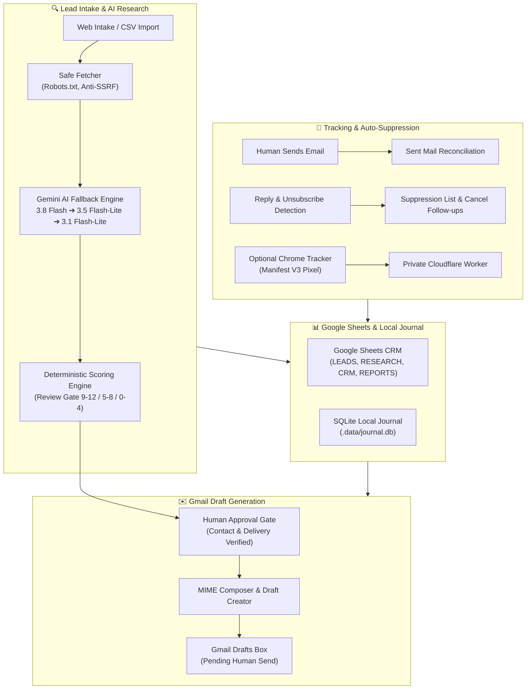

# 🏢 Agency Automater — Local B2B Acquisition & Outreach Assistant

<div align="center">

[](https://nodejs.org/)
[](https://n8n.io/)
[](#tests)
[](https://developers.google.com/)
[](https://aistudio.google.com/)
[](extension/)
[](#draft-only-safety)

**A private, local acquisition workflow assistant for IT founders. Researches target businesses, orchestrates Google Sheets CRM, scores opportunities deterministically, drafts hyper-personalized Gmail messages, and tracks opens — with 100% human-in-the-loop manual sending.**

[Quick Start](#-quick-start) • [System Architecture](#-system-architecture) • [Workflow Matrix](#-workflow-matrix) • [Outreach Lifecycle](#-outreach-lifecycle) • [Email Tracker](#-chrome-email-tracker) • [CLI Commands](#-cli-commands) • [Docs](docs/)

</div>

---

> [!IMPORTANT]
> **Zero-Send Security Guarantee**: This platform has **no programmatic email-sending endpoint**. All emails are composed exclusively as Gmail drafts for your personal review. You manually hit "Send" in Gmail. Automated follow-up clocks only tick after actual manual sends are reconciled.

---

## 🛠️ System Architecture



---

## ✨ Core Highlights

- **🔒 Local-First & Zero Paid Subscriptions**: Powered strictly by Node 24 built-in APIs, pinned **n8n Community Edition 2.42.6**, and free-tier Google & Gemini APIs. No monthly SaaS fees, no third-party data broker dependencies.
- **🛡️ SSRF & Web Crawler Guard**: Crawls strictly authorized public company pages (`/`, `/about`, `/contact`). Blocks private subnet lookups (DNS rebinding / RFC 1918 mitigation), respects `robots.txt`, and rejects scraping forms/social platforms.
- **🤖 Resilient Multi-Tier Gemini Fallback**: Gracefully degrades during quota pressure (`429`) or model outages:
  $$\text{gemini-3.8-flash} \longrightarrow \text{gemini-3.5-flash-lite} \longrightarrow \text{gemini-3.1-flash-lite}$$
  Includes automatic cooldown caching (5m for rate limits, 1h for 404s) and strict daily request capping.
- **🎯 Deterministic Evidence-Based Scoring**: Evaluates real observations against a 12-point matrix. Eliminates LLM hallucination by verifying quotes against collected source URLs.
- **🛑 Autonomous Reply & Opt-Out Suppression**: Continuously scans incoming messages. Any reply, out-of-office message, or unsubscribe request immediately freezes pending follow-up schedules.
- **📊 Two-Way Reconciliation**: Monitors Gmail `Sent Mail` with exact `Message-ID` tracking. Follow-up sequences (4 days then 7 days) are scheduled solely from real, human-confirmed send timestamps.

---

## 🚀 Quick Start

### 1. Prerequisites
- **Node.js**: `v24.x` (LTS)
- **Git** & **PowerShell** (Windows)
- Google Cloud Project with **Gmail API** and **Google Sheets API** enabled ([Guide](docs/google-setup.md))
- Google AI Studio API Key ([Free tier](https://aistudio.google.com/))

### 2. Installation & Initialization

```powershell
# Clone and enter project directory
cd "D:\AI STUFF\PROJECTS\automater"

# Install pinned dependencies
npm install --no-fund

# Initialize environment configuration & generate secure tokens
npm run setup

# Run 98 offline unit tests
npm test
```

### 3. Configure `.env`
Edit the generated `.env` file with your credentials:
```ini
# Google Integration
GOOGLE_CLIENT_ID=your-desktop-client-id.apps.googleusercontent.com
GOOGLE_CLIENT_SECRET=your-desktop-client-secret
GOOGLE_SHEET_ID=your-google-sheet-id

# Gemini Free Tier
GEMINI_API_KEY=your-gemini-key
GEMINI_FREE_TIER_CONFIRMED=true
GEMINI_MODEL=gemini-3.5-flash-lite

# Sender & Identity
SENDER_NAME="Your Name"
SENDER_TITLE="Founder & Lead Architect"
SENDER_EMAIL=you@example.com
SENDER_POSTAL_ADDRESS="Your City, Postal Code, Country"
OUTREACH_MODE=test
TEST_RECIPIENTS=your-testing-inbox@example.com
```

### 4. Authorize Google Account & Run Doctor
```powershell
# Run OAuth login flow (Desktop OAuth consent)
npm run auth

# Run system diagnostic checks
npm run doctor

# Start local helper and n8n engine
npm start
```
*Open **http://localhost:5678** to create your local n8n owner credentials.*

---

## 🔄 Workflow Matrix

The system includes **11 production-ready n8n workflows** located in `workflows/`:

| Workflow ID | Workflow Name | Description | Schedule |
|---|---|---|---|
| `00` | **Lead Intake** | Ingests URLs/CSVs, generates stable IDs, removes duplicates | Every 30 mins |
| `A` | **Lead Research** | Fetches public pages & extracts evidence via Gemini | Daily @ 09:00 (up to 3 leads) |
| `B` | **Lead Qualification** | Evaluates reviewed evidence score (9-12 = Tier A, 5-8 = Tier B) | Daily @ 10:15 |
| `C` | **Gmail Drafts for Review** | Formats verified evidence and outputs Gmail review drafts | Daily @ 11:00 (up to 3 drafts) |
| `D` | **Reply & Opt-Out Guard** | Detects prospect replies, halts sequence, records suppressions | Every 30 mins |
| `Sync` | **Sent Mail Reconciliation** | Verifies manual human send timestamps from Gmail Sent | Every 30 mins |
| `E` | **Follow-up Drafts** | Queues Stage 1 (4d) and Stage 2 (7d) follow-up drafts | Daily @ 12:00 |
| `F` | **Daily Business Report** | Computes pipeline metrics into Google Sheets and local log | Daily @ 18:00 |
| `G` | **Error Monitoring** | Central n8n execution error capture and audit journal | On Error Trigger |
| `Test` | **Local Connection Test** | End-to-end sanity check between n8n and local helper | Manual |
| `Track` | **Tracking Sync (Optional)** | Synchronizes email open events from Cloudflare tracker | Hourly |

Import all workflows into n8n via:
```powershell
npm run workflows:import
```

---

## 🎯 Outreach Lifecycle

```
[Target URL] ➔ Lead Intake ➔ Safe Web Fetch ➔ Gemini Research ➔ Human Score Review
                                                                        ↓
[Gmail Sent Box] ⟵ Manual Review & Send ⟵ Gmail Draft Created ⟵ Approved Tier A
       ↓
Reconciliation ➔ Follow-up Timer Armed ➔ Stage 1 / Stage 2 Follow-Up Drafts
       ↓
Prospect Replies ➔ Immediate Sequence Cancellation & Suppression
```

---

## 🧩 Chrome Email Tracker

Located in [`extension/`](extension/) with full documentation in [docs/mail-tracker.md](docs/mail-tracker.md):
- **Manifest V3 Architecture**: Zero DOM pollution, isolated credentials.
- **Gmail Composer Toggle**: Per-message tracking toggle embedded right in the Gmail compose toolbar.
- **Edge Deployment**: Backed by an ultra-lightweight Cloudflare Worker and D1 database.
- **Anti-False Positive**: Filters scanner pre-fetches, head requests, and immediate previews within 45 seconds of sending.

---

## 💻 CLI Commands

Run these management utilities from PowerShell while the helper is running:

```powershell
# Diagnostics & Health
npm run doctor               # Inspect dependencies, permissions & config
npm run check                # Lint and code validation
npm run gemini:test          # Probe Gemini API quota & model availability

# Manual Workflow Triggers
npm run run -- intake        # Ingest new leads from LEADS tab
npm run run -- research      # Perform evidence extraction
npm run run -- qualify       # Run qualification scoring
npm run run -- drafts        # Generate pending review drafts
npm run run -- reconcile     # Check Gmail Sent items
npm run run -- replies       # Check incoming replies & opt-outs
npm run run -- followups     # Generate due follow-up drafts
npm run run -- report        # Build daily status summary
npm run run -- recover       # Recover uncertain draft operations

# Data Import
npm run leads:import -- sample-data/first-10-leads.csv
```

---

## 🧪 Tests

```powershell
npm test
```
Runs the **98 unit and integration tests** verifying:
- SSRF prevention & DNS rebinding defenses
- Multi-tier Gemini model degradation & quota accounting
- MIME composition and RFC compliance
- Reply parser and unsubscribe heuristics
- Chrome extension Manifest V3 contract
- Idempotency and crash-resilient journal recovery

---

## 📁 Repository Structure

```
agency-automater/
├── docs/                     # Comprehensive architectural & operational guides
│   ├── google-setup.md       # OAuth Desktop Client setup instructions
│   ├── live-testing.md       # Safe self-test walkthrough
│   ├── mail-tracker.md       # Cloudflare Worker + Chrome extension setup
│   ├── operations.md         # Journal recovery, privacy & maintenance
│   ├── scoring.md            # Deterministic 12-point rubric guide
│   └── validation.md         # Audit details and test matrices
├── extension/                # Chrome Extension Manifest V3 (Gmail tracker)
├── prompts/                  # 7 hardened AI prompts with strict schema outputs
├── scripts/                  # CLI task executors, OAuth handlers, and n8n helpers
├── src/                      # Core logic (Google/Gemini clients, MIME, journal)
├── templates/                # 5-tab CRM Excel workbook and CSV schemas
├── tests/                    # 98 Node.js native test suites
├── tracker/                  # Cloudflare Worker edge tracking service
├── workflows/                # 11 native n8n workflow definitions (JSON)
├── install.cmd               # 1-click Windows installer
├── start.cmd                 # 1-click launcher for helper + n8n
├── package.json              # Project definition & pinned scripts
└── README.md                 # Project documentation
```

---

<div align="center">
  <sub>Engineered for reliability, privacy, and full human control.</sub>
</div>
